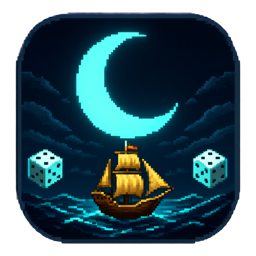

<!-- Improved compatibility of back to top link: See: https://github.com/othneildrew/Best-README-Template/pull/73 -->
<a id="readme-top"></a>

<!-- PROJECT SHIELDS -->
[![Contributors][contributors-shield]][contributors-url]
[![Forks][forks-shield]][forks-url]
[![Stargazers][stars-shield]][stars-url]
[![Issues][issues-shield]][issues-url]
[![License][license-shield]][license-url]
[![Powered by dsh][dsh-shield]][dsh-url]


<!-- PROJECT LOGO -->
<br />
<div align="center">
  <a href="https://github.com/madbarasa/Dice-Sorrow">
    
  </a>

  <h1 align="center">骰骨之海</h1>
  <h3 align="center">Dice Sorrow</h3>

  <p align="center">
    一款像素风格的回合制海战游戏，骰子既是战舰的血液，也是火力的来源。
    <br />
    <a href="GAME_DESIGN_DOCUMENT.md"><strong>查看游戏策划文档 »</strong></a>
    <br />
    <br />
    <a href="https://madbarasa.github.io/Dice-Sorrow/"><strong>在线试玩 »</strong></a>
    <br />
    <a href="https://github.com/madbarasa/Dice-Sorrow">查看仓库</a>
    &middot;
    <a href="https://github.com/madbarasa/Dice-Sorrow/issues/new?labels=bug">报告缺陷</a>
    &middot;
    <a href="https://github.com/madbarasa/Dice-Sorrow/issues/new?labels=enhancement">提出建议</a>
  </p>
</div>


<!-- TABLE OF CONTENTS -->
<details>
  <summary>目录</summary>
  <ol>
    <li>
      <a href="#about-the-project">项目介绍</a>
      <ul>
        <li><a href="#built-with">技术构成</a></li>
      </ul>
    </li>
    <li>
      <a href="#getting-started">开始使用</a>
      <ul>
        <li><a href="#prerequisites">环境要求</a></li>
        <li><a href="#installation">安装与运行</a></li>
      </ul>
    </li>
    <li><a href="#usage">玩法说明</a></li>
    <li><a href="#roadmap">开发路线</a></li>
    <li><a href="#contributing">参与贡献</a></li>
    <li><a href="#license">许可证</a></li>
    <li><a href="#contact">联系方式</a></li>
    <li><a href="#acknowledgments">致谢</a></li>
  </ol>
</details>


<!-- ABOUT THE PROJECT -->
## 项目介绍

《骰骨之海》是一款像素风格的回合制海战游戏。你扮演一名船长，驾驶一艘由骰子驱动的战舰，在风暴肆虐的海域中航行十三场战斗。每枚骰子的点数既是它的耐久，也是攻击力的上限；投出的点数总和决定这一轮炮击的伤害。击败敌舰后可以打捞它的骰子来强化自己，途中还能获得五种各不相同的神器。

游戏包含以下特色：

* **骰子即生命**：骰子同时承担血量与输出，攻防一体。
* **重新校准**：每回合一次重掷机会，在风险与收益之间做取舍。
* **五种神器**：霜冻、中继器、爆破者、燃烧弹、装甲弹，敌我双方均可使用。
* **战利品构建**：每场胜利都能打捞骰子，逐步壮大自己的舰队。
* **十三场战斗**：敌方阵容逐场变强，并穿插闪击与神秘商人。

完整的世界观与玩法设定请见 [游戏策划文档](GAME_DESIGN_DOCUMENT.md)。

<p align="right">(<a href="#readme-top">返回顶部</a>)</p>


### 技术构成

项目使用 Cloudflare Workers 承载，配表数据存放于 D1 数据库。游戏前端运行文件位于 `public/` 目录。

* [![TypeScript][TypeScript]][TypeScript-url]
* [![JavaScript][JavaScript]][JavaScript-url]
* [![Hono][Hono]][Hono-url]
* [![Cloudflare][Cloudflare]][Cloudflare-url]
* [![HTML5][HTML5]][HTML5-url]
* [![Canvas][Canvas]][Canvas-url]

<p align="right">(<a href="#readme-top">返回顶部</a>)</p>


<!-- GETTING STARTED -->
## 开始使用

无需安装即可在浏览器中直接试玩：[https://madbarasa.github.io/Dice-Sorrow/](https://madbarasa.github.io/Dice-Sorrow/)

以下是在本地运行项目的步骤。

### 环境要求

* Node.js
* npm

```sh
node --version
npm --version
```

### 安装与运行

1. 克隆仓库

   ```sh
   git clone https://github.com/madbarasa/Dice-Sorrow.git
   cd Dice-Sorrow
   ```

2. 安装依赖

   ```sh
   npm install
   ```

3. 本地启动

   ```sh
   npm run dev
   ```

4. 部署到 Cloudflare

   ```sh
   npm run deploy
   ```

配置数值通过 D1 数据库下发，支持在线调参而无需重新发版。拉取失败或以本地文件方式直接打开时，游戏会自动使用内置的兜底默认值，仍可正常游玩。

<p align="right">(<a href="#readme-top">返回顶部</a>)</p>


<!-- USAGE EXAMPLES -->
## 玩法说明

* 点击**开火**，参与进攻的骰子各掷一次，点数总和即为本次伤害。
* 对点数不满意时，可选择**重新校准**，每回合限用一次。
* 炮弹命中敌舰最前排的骰子，伤害超过其耐久的部分为溢出伤害，持有爆破者时会继续波及下一个骰子。
* 击败敌舰后，在打捞界面随机抽取一枚骰子加入自己的舰队。
* 首次失败后神秘商人出现，可以三选一获得神器，开启后续的新手教程流程。

完整规则与关卡数值请见 [游戏策划文档](GAME_DESIGN_DOCUMENT.md)。

<p align="right">(<a href="#readme-top">返回顶部</a>)</p>


<!-- ROADMAP -->
## 开发路线

- [x] 核心战斗与掷骰机制
- [x] 五种神器与敌我通用机制
- [x] 战利品打捞与神秘商人
- [x] 新手教程与启动分流
- [x] 云端配表与在线调参
- [ ] 无限模式
- [ ] 成就系统与图鉴
- [ ] 随机关卡与首领战
- [ ] 多人对战与自定义舰船

完整的版本记录请见 [changelog.txt](changelog.txt)。

<p align="right">(<a href="#readme-top">返回顶部</a>)</p>


<!-- CONTRIBUTING -->
## 参与贡献

欢迎任何形式的贡献，你的每一份帮助都至关重要。

如果你有改进建议，可以 fork 本仓库并提交 Pull Request，也可以直接创建一个带有 `enhancement` 标签的 issue。别忘了给项目点一个星标！

1. Fork 本仓库
2. 创建功能分支（`git checkout -b feature/AmazingFeature`）
3. 提交改动（`git commit -m 'Add some AmazingFeature'`）
4. 推送到分支（`git push origin feature/AmazingFeature`）
5. 提交 Pull Request

<p align="right">(<a href="#readme-top">返回顶部</a>)</p>


<!-- LICENSE -->
## 许可证

本项目暂未指定开源许可证。如需使用或分发，请联系项目作者。

<p align="right">(<a href="#readme-top">返回顶部</a>)</p>


<!-- CONTACT -->
## 联系方式

项目作者：madbarasa

项目地址：[https://github.com/madbarasa/Dice-Sorrow](https://github.com/madbarasa/Dice-Sorrow)

问题反馈：[https://github.com/madbarasa/Dice-Sorrow/issues](https://github.com/madbarasa/Dice-Sorrow/issues)

<p align="right">(<a href="#readme-top">返回顶部</a>)</p>


<!-- ACKNOWLEDGMENTS -->
## 致谢

* [Best-README-Template](https://github.com/othneildrew/Best-README-Template)
* [Shields.io](https://shields.io)
* [Cloudflare Workers](https://workers.cloudflare.com/)
* [Hono](https://hono.dev/)
* [DeepSeek Harness](https://github.com/deepseek-ai/deepseek-harness)

<p align="right">(<a href="#readme-top">返回顶部</a>)</p>


<!-- MARKDOWN LINKS & IMAGES -->
[contributors-shield]: https://img.shields.io/github/contributors/madbarasa/Dice-Sorrow.svg?style=for-the-badge
[contributors-url]: https://github.com/madbarasa/Dice-Sorrow/graphs/contributors
[forks-shield]: https://img.shields.io/github/forks/madbarasa/Dice-Sorrow.svg?style=for-the-badge
[forks-url]: https://github.com/madbarasa/Dice-Sorrow/network/members
[stars-shield]: https://img.shields.io/github/stars/madbarasa/Dice-Sorrow.svg?style=for-the-badge
[stars-url]: https://github.com/madbarasa/Dice-Sorrow/stargazers
[issues-shield]: https://img.shields.io/github/issues/madbarasa/Dice-Sorrow.svg?style=for-the-badge
[issues-url]: https://github.com/madbarasa/Dice-Sorrow/issues
[license-shield]: https://img.shields.io/badge/license-none-gray.svg?style=for-the-badge
[license-url]: https://github.com/madbarasa/Dice-Sorrow
[dsh-shield]: https://img.shields.io/badge/powered_by-dsh-4D6BFE?style=for-the-badge&logo=deepseek&logoColor=white
[dsh-url]: https://github.com/deepseek-ai/deepseek-harness
[TypeScript]: https://img.shields.io/badge/TypeScript-3178C6?style=for-the-badge&logo=typescript&logoColor=white
[TypeScript-url]: https://www.typescriptlang.org/
[JavaScript]: https://img.shields.io/badge/JavaScript-F7DF1E?style=for-the-badge&logo=javascript&logoColor=black
[JavaScript-url]: https://www.javascript.com/
[Hono]: https://img.shields.io/badge/Hono-orange?style=for-the-badge
[Hono-url]: https://hono.dev/
[Cloudflare]: https://img.shields.io/badge/Cloudflare-F38020?style=for-the-badge&logo=cloudflare&logoColor=white
[Cloudflare-url]: https://workers.cloudflare.com/
[HTML5]: https://img.shields.io/badge/HTML5-E34F26?style=for-the-badge&logo=html5&logoColor=white
[HTML5-url]: https://www.w3.org/html/
[Canvas]: https://img.shields.io/badge/Canvas-2D-gray?style=for-the-badge
[Canvas-url]: https://developer.mozilla.org/en-US/docs/Web/API/Canvas_API
